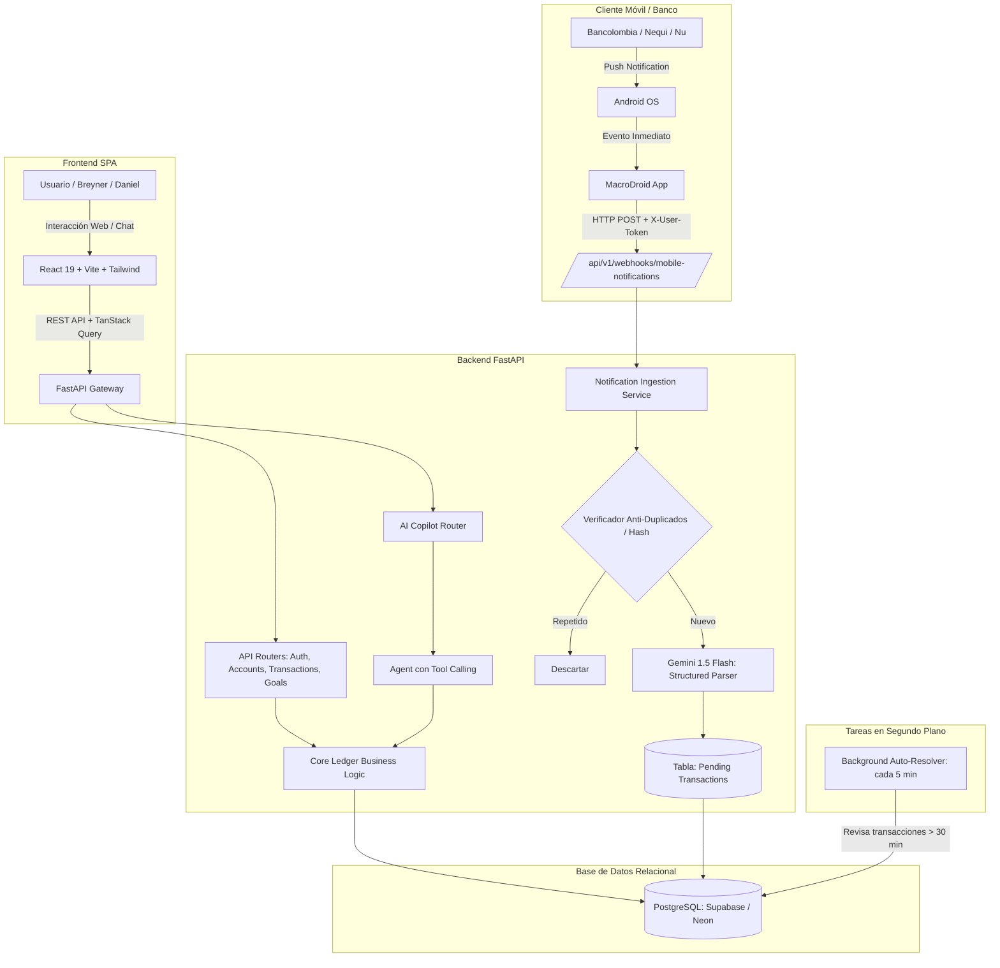
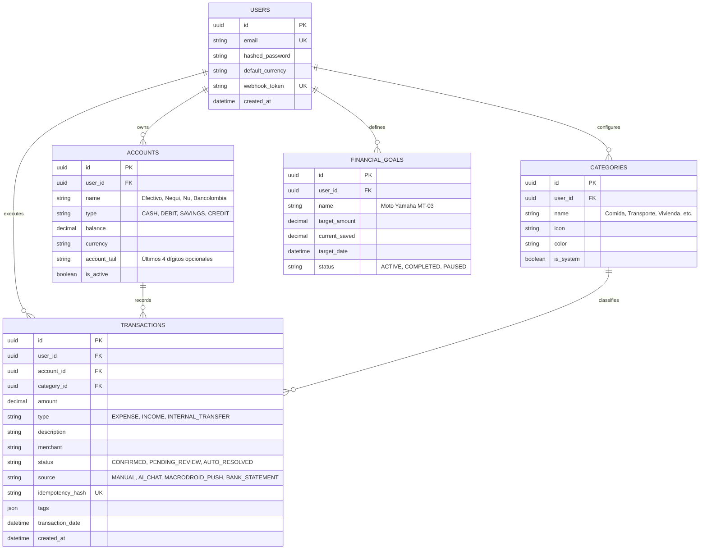
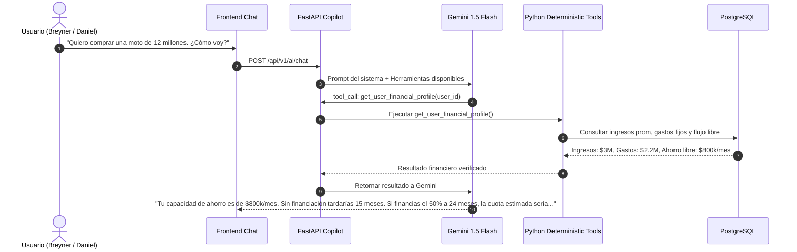

# Especificación de Arquitectura de Software: Draftly

> **Versión:** 1.0.0  
> **Fecha:** Octubre 2026  
> **Autores:** Breyner & Daniel  
> **Rol:** Lead Software Architecture Spec  

---

## 1. Visión General del Sistema

**Draftly** es una plataforma web full-stack de finanzas personales que une tres pilares:
1. **Core Ledger Determinista:** Un libro contable relacional que garantiza precisión matemática absoluta en balances, ingresos, egresos y transferencias entre cuentas (efectivo, bancos y billeteras digitales).
2. **Ingesta Autónoma de Movimientos:** Captura de notificaciones bancarias de Colombia (Bancolombia, Nequi, Nu) en tiempo real mediante un Webhook alimentado por MacroDroid en Android sin intermediarios de pago ni scrapers frágiles.
3. **Copilot Financiero con IA:** Asistente conversacional con *Structured Outputs* y *Tool Calling* respaldado por Google Gemini 1.5 Flash (Tier gratuito), capaz de registrar gastos en lenguaje natural, auditar balances y simular metas financieras (ej. compra de moto o vehículo).

---

## 2. Diagrama de Arquitectura Global

---

## 3. Modelo del Core Ledger (Base de Datos)

Las finanzas personales no son una simple lista plana de gastos. Cada movimiento afecta una cuenta origen y, en caso de transferencias o retiros, una cuenta destino.

### Entidades Principales

### Reglas Contables del Negocio
1. **Gasto (`EXPENSE`):** Disminuye el balance de la cuenta seleccionada (`ACCOUNTS.balance -= amount`).
2. **Ingreso (`INCOME`):** Aumenta el balance de la cuenta seleccionada (`ACCOUNTS.balance += amount`).
3. **Transferencia Interna (`INTERNAL_TRANSFER`):** Por ejemplo, un retiro en cajero de Nequi a Efectivo. Descuenta de la cuenta bancaria y acredita al bolsillo de Efectivo sin alterar el patrimonio total.
4. **Idempotencia (`idempotency_hash`):** Generado como $\text{SHA256}(\text{user\_id} + \text{amount} + \text{account} + \text{date\_minute})$. Si la notificación llega dos veces por SMS y por Push, la segunda se descarta.

---

## 4. Ciclo de Vida de Transacciones con IA y Timeout de 30 Minutos

Para no obligar al usuario a clasificar todo inmediatamente ni categorizar erróneamente:

1. **Ingesta Inmediata:** Llega la notificación push desde el teléfono.
2. **Extracción Estructurada:** Gemini 1.5 Flash extrae banco, monto, comercio y sugiere una categoría tentativa (ej. *Transporte*).
3. **Estado Inicial:** Se guarda con estado `PENDING_REVIEW`.
4. **Alerta en la App Web:** En el frontend se muestra una alerta tipo *Inbox*:
   > *"Movimiento detectado: -$15.000 en Nequi. ¿Deseas clasificarlo como Transporte?"*
5. **Acción del Usuario:**
   - Si el usuario hace click en **Aceptar**: pasa a estado `CONFIRMED` con la categoría sugerida.
   - Si el usuario selecciona **Cambiar**: se actualiza a la categoría elegida (ej. *Pasajes U*) y pasa a `CONFIRMED`.
6. **Resolución por Timeout (Regla de los 30 minutos):**
   - Si transcurren 30 minutos sin interacción, una tarea en segundo plano actualiza la transacción a:
     - `status`: `AUTO_RESOLVED`
     - `category`: `Gastos Generales`
     - `tags`: `["no_detallado", "autoresuelto"]`
   - El usuario siempre puede re-editarla en el historial cuando desee.

---

## 5. Arquitectura del Asistente y Simulador de Metas

El chat financiero no utiliza un RAG documental plano; utiliza **Tool Calling (Function Calling)** para no alucinar números:

---

## 6. Seguridad y Cero Costo de Operación

- **Autenticación Web:** JSON Web Tokens (JWT) con expiración y cookies HttpOnly o Bearer headers.
- **Autenticación de Notificaciones Móviles:** Header `X-User-Webhook-Token` único por usuario, revocable desde el panel de configuración.
- **Costos de Infraestructura:**
  - Base de Datos: **Supabase** Free Tier (500 MB Postgres con backups).
  - API Backend: **Render** / **Railway** Free o Starter.
  - Frontend: **Vercel** / **Cloudflare Pages** Free Tier.
  - IA / LLM: **Google Gemini 1.5 Flash** (15 RPM y 1M tokens/día gratuitos en Google AI Studio).
  - Telemetría Móvil: **MacroDroid** (Gratuito en Android hasta 7 macros).
  - **Costo mensual total esperado para desarrollo y MVP:** **\$0.00 USD**.
