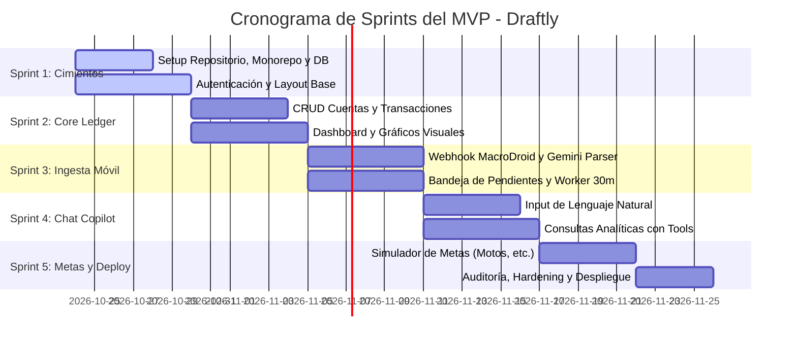

# Plan de Desarrollo del MVP & Backlog de Sprints: Draftly

> **Equipo:** Breyner (Dev 1) & Daniel (Dev 2)  
> **Metodología:** Sprints ágiles de 1 a 2 semanas  
> **Objetivo:** Producto Mínimo Viable (MVP) funcional, testeado y desplegado con costo \$0.

---

## 1. Alcance del MVP (Definición de Hecho)

El MVP estará listo cuando el usuario pueda:
1. Crear una cuenta y configurar sus bolsillos principales (Efectivo, Nequi, Bancolombia, etc.).
2. Recibir una notificación en su teléfono de Nequi/Bancolombia y verla aparecer automáticamente en la app en segundos.
3. Clasificar el movimiento pendiente o dejar que tras 30 minutos se asigne automáticamente a *Gastos Generales*.
4. Registrar un gasto hablando o escribiendo: *"Me gasté 100 mil en ir a la U"*.
5. Ver su balance real, gráficos de gastos por categoría e ingresos vs egresos.
6. Preguntarle al Copilot: *"Quiero comprar una moto de 12 millones, ¿cómo puedo pagarla?"* y recibir un plan de ahorro y crédito viable.

---

## 2. Mapa de Sprints y Distribución de Trabajo

---

## 3. Detalle de Tareas por Sprint

## 3. Detalle de Tareas por Sprint (Distribución Full-Stack Equitativa)

> Ambos desarrolladores (**Breyner** y **Daniel**) desarrollan de forma Full-Stack, participando activamente tanto en Frontend como en Backend a lo largo de los sprints.

### Sprint 1: Cimientos, Base de Datos y Autenticación
* **Meta:** Repositorio estructurado, backend FastAPI dockerizado corriendo con PostgreSQL, y frontend React con login y navegación base.

| Tarea | Área | Responsable | Rama Asignada | Entregable Técnico |
| :--- | :--- | :--- | :--- | :--- |
| **S1-01: Backend & Docker Scaffold** | Backend | **Daniel** | `feature/s1-01-backend-scaffold` | FastAPI modular, Dockerfile, docker-compose, Multi-IA y tests. *(Listo ✅)* |
| **S1-02: Scaffolding Frontend** | Frontend | **Breyner** | `feature/s1-02-frontend-scaffold` | React 19 + Vite + TypeScript + Tailwind CSS + shadcn/ui. |
| **S1-03: Modelos de DB & Migraciones** | Backend | **Breyner** | `feature/s1-03-db-models` | Tablas `User`, `Account`, `Category`, `Transaction` con `NUMERIC(14,2)` y Alembic. |
| **S1-04A: Endpoints de Auth JWT** | Backend | **Daniel** | `feature/s1-04-auth-api` | Rutas `/auth/register` y `/auth/login` con hashing y tokens JWT. |
| **S1-04B: Pantallas de Login & Registro** | Frontend | **Daniel** | `feature/s1-04-auth-ui` | Vistas de Auth en React, validación de formularios y guardias de ruta. |
| **S1-05: Layout Principal & Navegación** | Frontend | **Breyner** | `feature/s1-05-main-layout` | Sidebar colapsable, Header con perfil y navegación responsiva. |

---

### Sprint 2: Core Ledger & Dashboard Visual
* **Meta:** Gestión completa de cuentas (bolsillos), registro manual de gastos y dashboard con métricas.

| Tarea | Área | Responsable | Rama Asignada | Entregable Técnico |
| :--- | :--- | :--- | :--- | :--- |
| **S2-01: API de Cuentas & Categorías** | Backend | **Breyner** | `feature/s2-01-accounts-api` | CRUD de cuentas (Nequi, Efectivo, Bancos) y categorías personalizadas. |
| **S2-02: API de Transacciones & Filtros** | Backend | **Daniel** | `feature/s2-02-transactions-api` | CRUD de transacciones con afectación de balance y filtros por fecha/tipo. |
| **S2-03: UI de Gestión de Cuentas** | Frontend | **Breyner** | `feature/s2-03-accounts-ui` | Cards interactivas con balances por bolsillo (colores Nequi, Nu, Bancolombia). |
| **S2-04: UI Tabla de Transacciones** | Frontend | **Daniel** | `feature/s2-04-transactions-ui` | Data-table con paginación, búsqueda por comercio, filtros y badges. |
| **S2-05: Dashboard con Métricas** | Frontend | **Breyner** | `feature/s2-05-dashboard-metrics`| Cards de Balance Total/Ingresos/Gastos y gráfico de dona con Recharts. |

---

### Sprint 3: Ingesta Móvil (MacroDroid) & Bandeja de Pendientes
* **Meta:** Captura automática de notificaciones de Nequi, Bancolombia y Nu con regla de timeout de 30 min.

| Tarea | Área | Responsable | Rama Asignada | Entregable Técnico |
| :--- | :--- | :--- | :--- | :--- |
| **S3-01: Endpoint de Webhook Móvil** | Backend | **Daniel** | `feature/s3-01-webhook-macrodroid` | `/api/v1/webhooks/mobile-notifications` autenticado con `X-User-Token`. |
| **S3-02: Gemini Parser Estructurado** | Backend / AI | **Breyner** | `feature/s3-02-gemini-parser` | Extracción estricta Pydantic (monto, comercio, tipo) y descarte de phishing. |
| **S3-03: Prevención de Duplicados** | Backend | **Daniel** | `feature/s3-03-idempotency-hash` | Hash SHA-256 para evitar duplicar movimientos entre SMS y Push. |
| **S3-04: Worker de Timeout (30 min)** | Backend | **Daniel** | `feature/s3-04-timeout-worker` | Tarea en background que pasa transacciones inactivas a *Gastos Generales*. |
| **S3-05: UI Bandeja de Pendientes (Inbox)**| Frontend | **Breyner** | `feature/s3-05-pending-inbox-ui` | Banner superior en la app con confirmación o reclasificación en 1 click. |
| **S3-06: Pantalla Configuración Móvil** | Frontend | **Daniel** | `feature/s3-06-mobile-setup-ui` | Vista para copiar el Token personal y tutorial visual de MacroDroid. |

---

### Sprint 4: Smart Natural Language Input & Copilot de Consultas
* **Meta:** Registrar gastos con texto/voz libre y asistente conversacional para consultas exactas.

| Tarea | Área | Responsable | Rama Asignada | Entregable Técnico |
| :--- | :--- | :--- | :--- | :--- |
| **S4-01: Endpoint de Parseo de Texto** | Backend / AI | **Daniel** | `feature/s4-01-ai-text-parse` | Endpoint `/ai/parse-text` que convierte frases libres en transacciones. |
| **S4-02: Floating Quick-Input UI** | Frontend | **Breyner** | `feature/s4-02-quick-input-ui` | Barra estilo Spotlight con atajo de teclado y dictado por voz Web Speech API. |
| **S4-03: Agente con Tool Calling** | Backend / AI | **Breyner** | `feature/s4-03-copilot-tools` | Agente IA con funciones SQL deterministas (`get_monthly_spending`, etc.). |
| **S4-04: Chat Drawer / Asistente UI** | Frontend | **Daniel** | `feature/s4-04-copilot-chat-ui`| Panel lateral desplegable tipo Copilot con streaming y gráficos incrustados. |

---

### Sprint 5: Simulador de Metas Financieras, Auditoría & Despliegue
* **Meta:** Simulación de metas (ej. comprar moto), auditoría integral y despliegue a producción gratuito.

| Tarea | Área | Responsable | Rama Asignada | Entregable Técnico |
| :--- | :--- | :--- | :--- | :--- |
| **S5-01: Motor de Proyección de Metas** | Backend | **Daniel** | `feature/s5-01-goals-engine` | Algoritmo que calcula tiempo de ahorro según cashflow libre o cuotas de crédito. |
| **S5-02: UI de Metas de Ahorro** | Frontend | **Breyner** | `feature/s5-02-goals-ui` | Barra de progreso de la meta con sliders interactivos de ahorro mensual y tiempo. |
| **S5-03: Auditoría Pre-Deploy** | Fullstack | **Breyner & Daniel** | `feature/s5-03-audit-pre-deploy` | Pipeline Zen: OWASP, linter, tests unitarios y accesibilidad WCAG. |
| **S5-04: Despliegue Producción (\$0)** | DevOps | **Breyner & Daniel** | `feature/s5-04-prod-deploy` | Frontend en Vercel, Backend en Render/Railway y DB en Supabase. |

---

## 4. Guía de Trabajo en Pareja (Breyner & Daniel) y Política de Ramas

1. **Ramas Base:**
   - `main`: Código probado, auditado y listo para despliegue.
   - `develop`: Rama central donde se integran todas las funcionalidades del sprint.
2. **Creación Obligatoria de Ramas por Tarea:**
   - **Regla:** Cada desarrollador (Breyner o Daniel) **debe crear una rama nueva para cada tarea** antes de comenzar a codificar.
   - **Nomenclatura Estricta:**
     - `feature/<sprint>-<id>-<nombre>` $\rightarrow$ Ejemplos:
       - `feature/s1-01-scaffolding-fastapi`
       - `feature/s1-02-scaffolding-react`
       - `feature/s1-03-db-models`
       - `feature/s1-04-auth-flow`
     - `fix/<modulo>-<nombre>` $\rightarrow$ Ejemplo: `fix/db-connection-pool`
3. **Flujo de Integración:**
   - Desarrollar la tarea en su rama dedicada.
   - Ejecutar linter y tests locales (`pre-commit pipeline`).
   - Crear Pull Request de `feature/...` hacia `develop`.
   - El compañero revisa y aprueba el PR.
   - Se hace squash/merge a `develop`.
4. **Cierre de Sprint:** Solo cuando todas las tareas del sprint estén integradas y probadas en `develop`, se crea PR de `develop` hacia `main` para lanzamiento o release.
