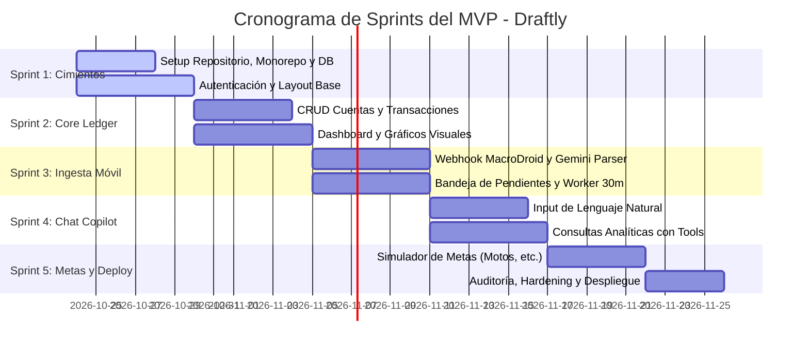

# Plan de Desarrollo del MVP & Backlog de Sprints: Draftly

> **Equipo:** Breyner (Dev 1) & Daniel (Dev 2)  
> **Metodología:** Sprints ágiles de 1 a 2 semanas  
> **Objetivo:** Producto Mínimo Viable (MVP) funcional, testeado y desplegado con costo \$0.

---

## 1. Alcance del MVP (Definición de Hecho)

El MVP estará listo cuando el usuario pueda:
1. Crear una cuenta y configurar sus bolsillos principales (Efectivo, Nequi, Bancolombia, etc.).
2. Recibir una notificación en su teléfono de Nequi/Bancolombia y verla aparecer automáticamente en la app en segundos.
3. Clasificar el movimiento pendiente o dejar que tras 30 minutos se asigne automáticamente a *Gastos Generales*.
4. Registrar un gasto hablando o escribiendo: *"Me gasté 100 mil en ir a la U"*.
5. Ver su balance real, gráficos de gastos por categoría e ingresos vs egresos.
6. Preguntarle al Copilot: *"Quiero comprar una moto de 12 millones, ¿cómo puedo pagarla?"* y recibir un plan de ahorro y crédito viable.

---

## 2. Mapa de Sprints y Distribución de Trabajo

---

## 3. Detalle de Tareas por Sprint

### Sprint 1: Cimientos, Base de Datos y Autenticación
* **Meta:** Repositorio estructurado, backend FastAPI corriendo con PostgreSQL en Supabase, y frontend React con login y navegación base.

| Tarea | Asignado | Entregable Técnico |
| :--- | :--- | :--- |
| **S1-01: Scaffolding Backend** | Dev Backend | Proyecto FastAPI modular con `venv`, `requirements.txt`, `alembic` y conexión a Supabase Postgres. |
| **S1-02: Scaffolding Frontend** | Dev Frontend | Proyecto React 19 + Vite + TypeScript + Tailwind CSS + componentes base de `shadcn/ui`. |
| **S1-03: Modelos de DB & Migración** | Dev Backend | Tablas `User`, `Account`, `Category`, `Transaction` y `PendingNotification`. |
| **S1-04: Módulo de Autenticación** | Dev Backend & Frontend | Endpoints de Register/Login con JWT en FastAPI; pantallas de Auth y guardias de ruta en React. |
| **S1-05: Layout Principal & Navegación** | Dev Frontend | Sidebar responsivo, Header con perfil de usuario y estado de conexión. |

---

### Sprint 2: Core Ledger & Dashboard Visual
* **Meta:** El usuario puede gestionar sus cuentas, registrar gastos manualmente y ver gráficos en tiempo real.

| Tarea | Asignado | Entregable Técnico |
| :--- | :--- | :--- |
| **S2-01: API de Cuentas & Categorías** | Dev Backend | Endpoints para crear/listar cuentas (Efectivo, Nequi, etc.) y categorías con balance dinámico. |
| **S2-02: API de Transacciones & Filtros** | Dev Backend | CRUD de transacciones con validación de balance y filtros por fecha, cuenta y tipo. |
| **S2-03: UI de Gestión de Cuentas** | Dev Frontend | Tarjetas visuales con balances de cada cuenta (Nequi morado, Bancolombia amarillo, etc.). |
| **S2-04: Tabla de Transacciones** | Dev Frontend | Data table interactiva con paginación, búsqueda y badge de categoría. |
| **S2-05: Dashboard con Métricas** | Dev Frontend | Cards de Ingresos/Gastos/Balance y gráfico de pastel/dona de gastos por categoría (Recharts). |

---

### Sprint 3: Ingesta Móvil (MacroDroid) & Bandeja de Pendientes
* **Meta:** Captura automática de notificaciones bancarias de Nequi, Bancolombia y Nu con resolución en 30 minutos.

| Tarea | Asignado | Entregable Técnico |
| :--- | :--- | :--- |
| **S3-01: Endpoint de Webhook Móvil** | Dev Backend | `/api/v1/webhooks/mobile-notifications` autenticado con `X-User-Token`. |
| **S3-02: Gemini Parser Estructurado** | Dev Backend | Integración con Gemini 1.5 Flash para extraer monto, comercio, tipo y descartar falsos positivos/links. |
| **S3-03: Prevención de Duplicados** | Dev Backend | Generación de hash de idempotencia para no registrar la misma compra dos veces. |
| **S3-04: Worker de Timeout (30 min)** | Dev Backend | Tarea en segundo plano (FastAPI background o Celery/cron) que pasa transacciones inactivas a *Gastos Generales*. |
| **S3-05: UI Bandeja de Pendientes (Inbox)**| Dev Frontend | Banner superior en la app que muestra movimientos por confirmar y permite clasificarlos en 1 click. |
| **S3-06: Pantalla de Configuración Móvil** | Dev Frontend | Vista donde el usuario copia su URL de webhook y Token para pegarlo en MacroDroid. |

---

### Sprint 4: Smart Natural Language Input & Copilot de Consultas
* **Meta:** Registrar gastos con frases libres y hacer preguntas analíticas al asistente sin errores de cálculo.

| Tarea | Asignado | Entregable Técnico |
| :--- | :--- | :--- |
| **S4-01: Endpoint de Parseo de Texto** | Dev Backend | `/api/v1/ai/parse-text` que convierte *"gasté 100k en ir a la u"* en un objeto de transacción listo para guardar. |
| **S4-02: Floating Quick-Input UI** | Dev Frontend | Barra de entrada rápida estilo "Spotlight" o cajita de chat con soporte de dictado por voz del navegador. |
| **S4-03: Agent con Tool Calling** | Dev Backend | Agente con acceso a herramientas SQL (`get_monthly_spending`, `get_category_totals`) para responder preguntas exactas. |
| **S4-04: Chat Drawer / Asistente UI** | Dev Frontend | Panel lateral desplegable tipo Copilot con streaming de respuestas y visualización de datos. |

---

### Sprint 5: Simulador de Metas Financieras, Auditoría & Despliegue
* **Meta:** Módulo de metas inteligentes (ej. comprar moto) y despliegue a producción gratuito.

| Tarea | Asignado | Entregable Técnico |
| :--- | :--- | :--- |
| **S5-01: Motor de Proyección de Metas** | Dev Backend | Algoritmo que calcula tiempo de ahorro según cashflow libre o cuotas de crédito estimadas. |
| **S5-02: UI de Metas de Ahorro** | Dev Frontend | Barra de progreso de la meta, simulación interactiva con sliders de tiempo y ahorro mensual. |
| **S5-03: Auditoría Pre-Deploy** | Dev 1 & Dev 2 | Pipeline Zen: revisión de seguridad OWASP, linters, tests unitarios y accesibilidad. |
| **S5-04: Despliegue Producción** | Dev 1 & Dev 2 | Frontend en Vercel, Backend en Render/Railway y DB en Supabase. |

---

## 4. Guía de Trabajo en Pareja (Breyner & Daniel) y Política de Ramas

1. **Ramas Base:**
   - `main`: Código probado, auditado y listo para despliegue.
   - `develop`: Rama central donde se integran todas las funcionalidades del sprint.
2. **Creación Obligatoria de Ramas por Tarea:**
   - **Regla:** Cada desarrollador (Breyner o Daniel) **debe crear una rama nueva para cada tarea** antes de comenzar a codificar.
   - **Nomenclatura Estricta:**
     - `feature/<sprint>-<id>-<nombre>` $\rightarrow$ Ejemplos:
       - `feature/s1-01-scaffolding-fastapi`
       - `feature/s1-02-scaffolding-react`
       - `feature/s1-03-db-models`
       - `feature/s1-04-auth-flow`
     - `fix/<modulo>-<nombre>` $\rightarrow$ Ejemplo: `fix/db-connection-pool`
3. **Flujo de Integración:**
   - Desarrollar la tarea en su rama dedicada.
   - Ejecutar linter y tests locales (`pre-commit pipeline`).
   - Crear Pull Request de `feature/...` hacia `develop`.
   - El compañero revisa y aprueba el PR.
   - Se hace squash/merge a `develop`.
4. **Cierre de Sprint:** Solo cuando todas las tareas del sprint estén integradas y probadas en `develop`, se crea PR de `develop` hacia `main` para lanzamiento o release.
